  

  
  
  

 

I'm an Informatics student in Indonesia working between backend development and security. I build APIs and the tools around them, then spend the rest of my time finding out how they break: reading logs, writing detections, and testing my own code the way an attacker would.

 

### what i've built

| | | |
|---|---|---|
| **[slotwise](https://github.com/hal-imaxabdi/slotwise)** | Booking platform where PostgreSQL itself blocks double bookings, even under simultaneous requests. [Live demo](https://slotwise-mocha.vercel.app) | `fastapi` `postgresql` `react` |
| **[dependency compass](https://github.com/hal-imaxabdi/Dependency-compass)** | Ranks vulnerable dependencies so the actively exploited ones get fixed first. Web app, CLI and GitHub Action. [Live demo](https://dependency-compass.onrender.com) | `python` `osv.dev` `ci` |
| **[flyrank billing engine](https://github.com/hal-imaxabdi/flyrank-billing-engine)** | Usage metering and billing API with exactly-once event recording and signed payment webhooks. | `fastapi` `postgresql` `docker` |
| **[hookline](https://github.com/hal-imaxabdi/hookline)** | Chrome extension that flags phishing and scam messages and explains why. [Web demo](https://hal-imaxabdi.github.io/hookline/demo/) | `typescript` `fastapi` |
| **[soc homelab](https://github.com/hal-imaxabdi/Soc-Homelab)** | Windows and Kali VMs shipping logs to Elastic SIEM, with custom detections mapped to MITRE ATT&CK. | `elastic` `sysmon` `kql` |
| **[waf homelab](https://github.com/hal-imaxabdi/WAF-HomeLab-SafeLine)** | SafeLine WAF in front of a vulnerable app, tested with SQL injection, XSS and command injection. | `safeline` `docker` `dvwa` |

 

### my toolkit

| | |
|---|---|
| **build** |      |
| **store** |   |
| **ship** |    |
| **secure** |    |
| **detect** |     |
| **lab** |    |

 

<code>build it. break it. secure it.</code>

  <picture>
    <source media="(prefers-color-scheme: dark)" srcset="https://raw.githubusercontent.com/hal-imaxabdi/hal-imaxabdi/output/github-snake-dark.svg?v=2" />
    
  </picture>

